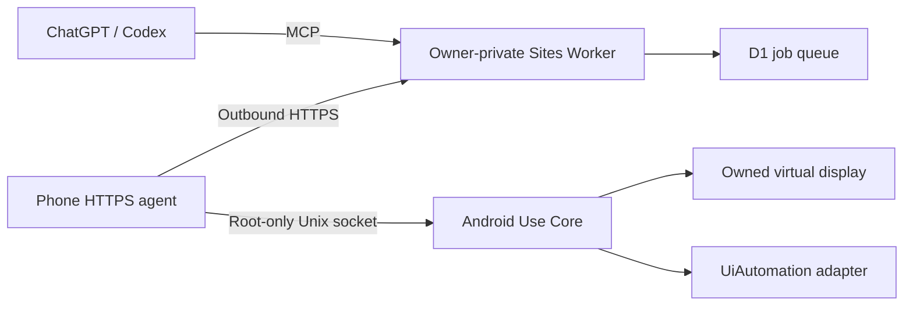

# Architecture

Mini Codex remains a separate system/files/maintenance assistant. Android Use controls a verified owned nonzero display. Apps can produce device-wide effects; display isolation does not isolate application data.

The Worker trusts Sites authentication at the hosting boundary and pins the authenticated owner. Every deployment uses a separate D1 database and AGENT_TOKEN. Do not expose it behind a proxy that lets callers forge Sites identity headers.

The agent has no incoming port. It verifies TLS, reuses HTTPS and journals normal jobs before execution. Request IDs distinguish retries from new actions; pending results preserve PNGs. Uncertain normal jobs block subsequent normal jobs; the published idle display cleanup is retained separately as a compatibility workaround.

Core refuses physical display 0 and missing isolation flags. The display owner has a ten-minute lease. The agent retains 120-second idle cleanup; Core removes verified virtual task stacks on stop; launch excludes tasks from Recents. Magisk starts transport/Core, not a virtual screen.

Package version: 0.0.3. Preserved phone Core/module: 0.0.1. Relay protocol server: 1.1.0. These are separate component versions.
